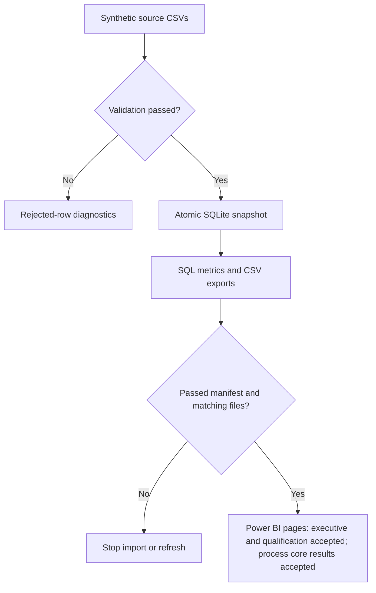

# Operational Readiness Intelligence

**Status: Day 9 technical/report checks accepted October 19, 2026.** Windows tests/export/import/model evidence and process-page global, selected, Open-only, empty, restoration, and both table-row results reconcile; reopening is user-confirmed. The user's completed-case denominator and blank-rate explanations are accepted. Only the own explanation of recomputing the combined median from individual cases needs refinement. Day 8 is complete; the prototype passed October 12. The October 19 MVP gate remains open, with no date/scope revision; polish remains October 30.

The synthetic process reference has **600 opened cases, 442 completed, 45 corrections (10.18%), median completed cycle 7 days, and 158 open cases with median age 27 days**. Rates use completed outcomes; medians use selected case durations, and open outcomes remain unknown. Repeated process exports match while the database, source/accepted files, and existing dashboard bundle retain their hashes. **60 Python tests pass on Linux and screenshot-verified Windows** (Windows: 44.115 seconds, OK). These tests do not execute M/DAX or Desktop.

Continue with [day09_windows_handoff.md](docs/day09_windows_handoff.md) and [day09_reconciliation.md](docs/day09_reconciliation.md). Implementation evidence: [verification_day09.md](docs/verification_day09.md), [process_check.json](docs/process_check.json), and the [October 19 MVP status checkpoint](docs/checkpoints/2026-10-19_mvp_status.md). The accepted [Day 8 checkpoint](docs/checkpoints/2026-10-17_day08.md) retains qualification/expiration evidence; earlier pages/measures are preserved. Exact installed report definitions and full type metadata remain uninspected.

Windows access is confirmed by the user: Desktop **2.158.1177.0, 64-bit (September 2026)**. Day 2 staffing screenshots show matching global/Unit C slicer results and the intended relationship; populated-learning-report save/reopen is user-confirmed. Evidence: `docs/verification_day02.md`. Day 6 executive-page acceptance is complete; later detail pages and release gates remain separate milestones.

This portfolio project supports a fictional operations manager deciding where to review staffing, qualification renewals, backup coverage, and administrative processes. All operational data and findings are **simulated**. Readiness measures are fictional proxies; they are not official Navy rules or statements about deployability.

The project demonstrates Python, relational SQL, data quality, and Power BI explanation for analyst/BI interviews. It does not establish production implementation experience or real-world predictive validity.

## Current scope and gates

- Six fictional units, 300 fictional people, eight qualification types.
- A single staffing snapshot fixed at **2026-10-07**; 90-day qualification outlook and 90-day administrative case window.
- Python → validation → SQLite → SQL-generated CSV → Power BI Desktop on Windows.
- Visible prototype: October 13. Interview-ready MVP: Monday, October 19. Polished flagship: October 30.
- HoH interview window: October 20–December 3. These dates and HoH events are supplied planning inputs, not independently verified event schedules.

The brainstorming chat remains the master record for priorities and major scope changes. This workspace uses decisions/checkpoints that the user brings between chats; it does not assume access to that chat.

## Start or resume

Read [charter](docs/charter.md), [progress](docs/progress.md), and [decisions](docs/decisions.md) before making changes. The attached schedule is preserved in [source_execution_plan.md](docs/source_execution_plan.md).

Existing Windows checkout: all Day 9 technical/report checks are accepted, including restoration, both table-row tests, and user-confirmed reopening. Continue at [handoff section 6](docs/day09_windows_handoff.md#6-remaining-completion-checks) with only the own combined-median explanation: pool eligible individual case durations in the selected scope; unit medians discard information even within one case type. No setup, test, export, screenshot, or reopening repeat is required. Keep the existing interpreter, sources/database, report, and earlier pages/measures. Run both input checkers immediately before a later import/refresh and keep files stable.

Use Python 3.11 or later from the project root:

```bash
python -m pip install -r requirements.txt
python src/check_environment.py
python src/generate_data.py
python src/inject_defects.py
python src/validate_data.py
python src/load_data.py
python src/export_metrics.py
python src/check_powerbi_input.py
python src/export_process_metrics.py
python src/check_process_input.py
python src/validate_data.py --input-dir data/raw/dirty --output-dir data/rejected/day03_dirty
python -m unittest discover -s tests -v
```

These commands show the full fresh-checkout order, not a request to repeat working setup. The environment checker executes the schema in memory. The generator creates `data/raw/clean/`; the injector writes `data/raw/dirty/` separately. Clean validation exits 0; intentional dirty validation exits **1** and blocks loading. `load_data.py` verifies passed source/export hashes and values, then loads `data/processed/readiness.sqlite3` in one transaction. Repeating it replaces the same snapshot without duplicates. Its audit is `data/processed/load_report.json`. `export_metrics.py` re-verifies the passed source/database, executes three queries in one read transaction, and writes `data/processed/dashboard/`. Only use its CSVs when `export_manifest.json` is passed, exports_ready is true, the date is correct, and hashes match. Generated datasets, audits, and databases are excluded from Git.

Current exports implement staffing, current qualification coverage/gaps/fragility, cumulative expiration inventory, and process volume/completed outcomes/current backlog. Process outputs use a separate `data/processed/dashboard/process/` bundle and `process_export_manifest.json`; old dashboard files/manifest are unchanged. Both exporters reconcile the passed source against the read-only database. Accepted rows in a failed diagnostic bundle are not approved analytics inputs. Executive, qualification/expiration, and process technical/report checks are accepted from user evidence; Day 9 retains only the own combined-median explanation. The deterministic no-renewal scenario remains Day 10.

## Prototype concept

| Capability | Current release state |
| --- | --- |
| Synthetic generation, validation, transactional SQLite loading | Built; Linux/Windows technical evidence recorded |
| Staffing, current qualification, cumulative expiration SQL/CSV exports | Built; expected grains, counts, repeat and preservation checks passed |
| Power BI executive page | Built; displayed metrics/filters/interactions verified; reopening user-confirmed |
| Short prototype explanation | User-provided version reviewed; rehearsal duration user-reported at about one minute |
| Qualification/expiration detail visuals | Day 8 complete; numeric, boundary, filter, empty, interaction, and user reopening evidence accepted |
| Administrative process metrics/view | Technical/report checks accepted; reopening user-confirmed; own combined-median explanation needs refinement |
| Deterministic no-renewal qualification scenario | Planned Day 10 |
| Machine learning | Outside this MVP |




The page helps a fictional manager compare local staffing gaps and qualification coverage. Staffing and qualification slots are separate measures. Screenshots reconcile global, Unit C, zero-gap Unit A, and weighted Unit A + C selections, clear/empty behavior, and the table-row interaction fix. This executive page supports the scheduled prototype review; the release gate also requires the user’s accurate walkthrough.

## Clean reference and planted evidence

All counts here are **simulated source audits**. CSV rows: 6 units, 300 people, 8 qualification types, 265 certificates, 48 unit/qualification requirements, 600 cases.

- Unit C: 40 available / 50 required (80%); a deliberately planted staffing shortfall.
- Unit B/Q03: one valid available holder for one required; deliberately fragile coverage.
- Unit D/Q04: six available holders all expiring within 30 days, including the November 6 endpoint. Recalculating the no-renewal gap remains Day 10.
- Unit F: 27 corrections / 70 completed cases (38.6%), from a configured 30% probability; elsewhere 18/372 (4.8%) from 6%. The rates were not forced to match the probabilities.

Generator verification: [verification_day02.md](docs/verification_day02.md). Day 5 SQL now reconciles global staffing **254/250 = 101.6%**, summed unit staffing gaps **10**, and qualification coverage **88/95 = 92.63%**, with **7 missing holder slots**. The 30-day inventory has **45 certificates affecting 41 distinct people**; cumulative windows overlap. Day 6 executive screenshots reconcile the displayed staffing/qualification results; Day 8 qualification/expiration displayed checks are accepted. These are simulated audits, not real-world findings. Source fields: [data_dictionary.md](docs/data_dictionary.md); export fields: [export_dictionary.md](docs/export_dictionary.md); calculation trace: [sql_walkthrough.md](docs/sql_walkthrough.md).

## Where the work lives

| Path | Current purpose |
| --- | --- |
| `config/project.yml` | Fixed seed, date, scope, and explicitly planted fictional scenarios |
| `src/check_environment.py` | Implemented Day 1 access/configuration/schema check |
| `src/generate_data.py` | Implemented fixed-seed clean generator with four explicit scenario overrides |
| `src/inject_defects.py` | Sixteen deterministic defects in a separate source copy; exact catalog and hashes |
| `src/validate_data.py` | Key/required/FK/date/type/lifecycle/completeness validation; explicit quarantine and whole-batch gate |
| `src/load_data.py` | Passed-bundle checks; atomic six-table snapshot replacement; exact values/counts; failure rollback |
| `src/export_metrics.py` | Read-only snapshot/source reconciliation, SQL execution, explicit-grain CSVs and refresh manifest |
| `src/check_powerbi_input.py` | Read-only manifest/hash/row/grain prerequisite immediately before Power BI import/refresh |
| `src/export_process_metrics.py`, `src/check_process_input.py` | Separate read-only process export and no-write hash/grain/lifecycle preflight |
| `tests/test_generate_data.py` | Eight clean-reference integration/reproducibility checks |
| `tests/test_validate_data.py` | Fourteen quality, reconciliation, preservation, and failure checks |
| `tests/test_load_data.py` | Ten persistence, repeatability, blocked-input, rollback, and asset-protection checks |
| `tests/test_export_metrics.py` | Ten independent metric, join/date, repeat, blocked-input, and export-failure checks |
| `tests/test_powerbi_input.py` | Seven no-write refresh-prerequisite and failure checks; not DAX/M execution |
| `tests/test_process_metrics.py` | Eleven process chronology, denominator, median, export-preservation, failure, and preflight checks |
| `sql/process_case_detail.sql`, `sql/process_metrics.sql` | As-of case fact and selected case-level process counts/rates/medians |
| `sql/schema.sql` | Executable SQLite source-table constraints used by the loader |
| `sql/unit_summary.sql`, `sql/qualification_detail.sql`, `sql/expiration_detail.sql` | Staffing, current qualification coverage, and cumulative expiration queries |
| `data/raw/`, `data/processed/`, `data/rejected/` | Clean/dirty inputs, passed clean records, and blocked dirty diagnostics |
| `tests/` | Reserved for meaningful data and metric checks as those implementations exist |
| `powerbi/build_instructions.md`, `docs/day06_windows_handoff.md` | Existing-folder executive-page import/build/filter/save steps |
| `powerbi/unit_summary.pq`, `powerbi/executive_measures.dax` | Gated M query and eleven ORI measures; displayed Desktop outputs verified, exact installed definitions uninspected |
| `docs/metric_contract.md` | Finalized v1.0 definitions, output grains, boundaries, and worked examples |
| `docs/schema_sketch.md`, `docs/data_dictionary.md` | Grain, joins, keys, and field meanings |
| `docs/environment.md`, `docs/verification_day01.md` | Observed access and verified limits |
| `docs/validation_rules.md`, `docs/defect_catalog.md`, `docs/verification_day03.md` | Rejection contract, injected errors, verified counts and limits |
| `docs/verification_day04.md`, `docs/load_check.json`, `docs/loader_walkthrough.md` | Persistent-load evidence and transaction explanation |
| `docs/verification_day05.md`, `docs/analytics_check.json`, `docs/sql_walkthrough.md` | SQL/CSV evidence, selected-unit hand check, and explanation |
| `docs/verification_day06.md`, `docs/powerbi_check.json`, `docs/sql_review_backlog.md` | Day 6 completion evidence, BI reconciliation and inspection limits, and carried SQL learning items |
| `docs/day07_windows_handoff.md`, `docs/verification_day07.md`, `docs/prototype_check.json` | Completed caption/demo guidance, reviewed user explanation, and passed prototype gate with evidence limits |
| `docs/checkpoints/2026-10-12_day07.md` | Passed prototype-gate report using actual screenshot/text evidence and user-reported timing |
| `powerbi/qualification_detail.pq`, `qualification_filter.pq`, `expiration_detail.pq`, `qualification_measures.dax` | Day 8 gated imports, shared qualification lookup, and sixteen scoped measures; displayed outputs accepted |
| `docs/day08_windows_handoff.md`, `day08_reconciliation.md`, `verification_day08.md`, `qualification_check.json` | Model/page instructions, read-only CSV references, accepted outputs and inspection limits |
| `powerbi/process_case_detail.pq`, `process_filter.pq`, `process_measures.dax` | 600-case import, four-type lookup, and ten ORI P measures; core Desktop results accepted |
| `docs/day09_windows_handoff.md`, `day09_reconciliation.md`, `verification_day09.md`, `process_check.json` | Process build steps, exact SQL references, executed evidence, accepted Desktop scopes, and remaining completion checks |
| `docs/progress.md`, `docs/decisions.md`, `docs/interview_feedback.md` | Daily state, decisions, and actual employer feedback |

## Limits and ownership

Staffing and qualification coverage are separate measures. A person can hold multiple qualifications, so qualification coverage cannot establish simultaneous assignment capacity. The no-renewal outlook will be a deterministic scenario. No ML, cloud, dbt, optimization, or extra project is included in this MVP.

The assistant prepares code, SQL, documentation, and build instructions. The user reviews and explains the work, builds/inspects the Power BI report locally, and supplies access results and employer feedback. Independent understanding is checked explicitly; it is not assumed from coursework or generated documentation. Day 5's LEFT JOIN, person/certificate grain, and fragility explanations need refinement and are carried forward under the user's explicit Day 6 instruction. No successful technical rerun is required merely to revisit those explanations.
