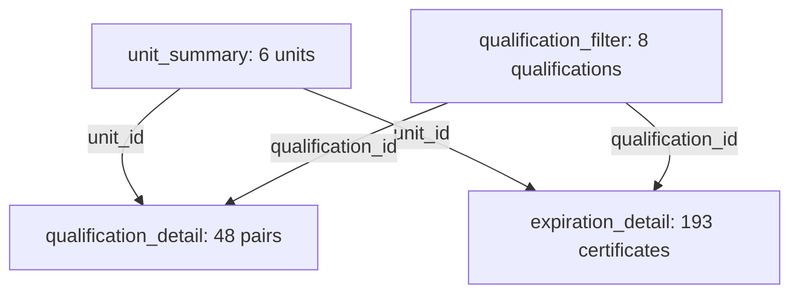

# Day 8 — build the qualification and expiration page

Started **October 13, 2026**, early at the user's instruction; source schedule: **October 14**. Metric date stays **2026-10-07**. The prototype gate passed Day 7. Today's page answers which current qualification pairs have shortages or no backup and whose current certificates expire within 30/60/90 days.

The local execution environment was unavailable during preparation and returned for screenshot review. **The assistant has not executed M/DAX/PowerShell or operated the PBIX.** October 13 follow-up screenshots establish a passed Windows input check and visible imported tables; model corrections, import count/type confirmation, and page verification remain open. Existing Python/SQL and their 49-test suite are unchanged; their prior passes do not test these new report definitions.

## 1. Update and check the existing saved exports

Use the existing Git-connected project folder containing `src`, `data`, and `powerbi`. After publication verification, run:

```powershell
& {
    $ErrorActionPreference = 'Stop'
    git pull --ff-only
    if ($LASTEXITCODE -ne 0) { throw 'Update stopped; preserve local work and return the output.' }
    .\.venv\Scripts\python.exe src\check_powerbi_input.py
    if ($LASTEXITCODE -ne 0) { throw 'Input check failed; return the output before importing or refreshing.' }
}
```

Expected checker: passed/exit 0; three matching-hash files; unique grains; row counts **6 / 48 / 193**; zero writes. Use the same saved database/CSVs, interpreter, working PBIX, and original learning report. No new daily folder, installation, regeneration, or reload is needed.

Run this checker immediately before every import/refresh and keep CSVs stable through the operation. M checks manifest, exact schema, types, date, grains, keys/labels, and value consistency; it does not compute SHA-256. The preflight and import are separate operations, not an atomic file transaction. A failed refresh can retain old cached report data.

## 2. Import three queries in order

Open the **working PBIX**. Retain `unit_summary` and all earlier queries/pages/measures. In **Transform data**, create a Blank Query and paste one WHOLE file into its Advanced Editor, naming the query exactly as below:

| Order | Query name | File | Expected result |
| --- | --- | --- | --- |
| 1 | qualification_detail | `powerbi/qualification_detail.pq` | 48 rows, 13 columns; one unit/qualification/date |
| 2 | qualification_filter | `powerbi/qualification_filter.pq` | 8 rows, 2 columns; one qualification ID/name |
| 3 | expiration_detail | `powerbi/expiration_detail.pq` | 193 rows, 14 columns; one current person/qualification/date |

In the two detail files, replace only `ProjectRoot` with the existing project root, **not the powerbi/PBIX subfolder**. The filter query references qualification_detail and needs no path edit. Its eight rows are a derived lookup, not another operational source dataset.

Count/flag/day-offset columns must be Whole Number, IDs/names/classification Text, dates Date, and the qualification ratio Decimal Number. Null undefined ratios remain null. Every fact row has the October 7 date and synthetic_only classification. Current expiration rows satisfy `valid_from <= D < expiration_date`. Preserve both availability values. Do not remove errors or deduplicate fact rows to force a successful import; return the exact query error.

Ensure Enable load is checked for all three queries. Keep input files stable, rerun the checker just before Close & Apply, then apply. Do not change the source files to match expected row counts.

## 3. Add four active, Single relationships

The existing six-row `unit_summary` now also supplies the unit lookup for the new detail tables. Its unique unit IDs and the new eight-row qualification lookup form the one sides. Create exactly these four relationships:

| One side | Many side | Cardinality | Direction | Active |
| --- | --- | --- | --- | --- |
| unit_summary[unit_id] | qualification_detail[unit_id] | 1:* | Single, from unit_summary | Yes |
| unit_summary[unit_id] | expiration_detail[unit_id] | 1:* | Single, from unit_summary | Yes |
| qualification_filter[qualification_id] | qualification_detail[qualification_id] | 1:* | Single, from qualification_filter | Yes |
| qualification_filter[qualification_id] | expiration_detail[qualification_id] | 1:* | Single, from qualification_filter | Yes |

In Model view, drag matching ID columns or use Manage relationships and the table/column selectors. Check cardinality, Single direction, and active status in each relationship dialog. If Power BI added different relationships automatically, remove only those new connections involving the new tables and configure this set. Preserve the original units-to-personnel learning relationship.

Do not connect the two detail tables to one another, connect them to the old raw personnel/units tables, use Both direction, or merge their rows into the unit summary. Those choices would change filter scope or multiply counts. Both shared slicers must reach both fact tables. Old executive measures continue to use the summary; qualification-specific measures below use qualification_detail.



**First review point:** return the input-check status/exit, three import counts/types, and a readable Model view screenshot showing these four relationships. This is enough to review the model before creating the new measures. It does not require repeating the accepted executive tests.

### October 13 review: correct the extra relationships

The supplied checker output reports passed, 6/48/193 rows, unique grains, three files checked, and zero writes. That check is accepted; an explicit process exit is outside the crop. The relationship images show two correct qualification links, two inactive intended unit links, and three unintended links to the old learning tables. In Manage relationships:

| Existing connection, shown from the many side | Action |
| --- | --- |
| expiration_detail[person_id] — personnel[person_id], inactive | Delete |
| expiration_detail[unit_id] — units[unit_id], active | Delete |
| qualification_detail[unit_id] — units[unit_id], active | Delete |
| expiration_detail[unit_id] — unit_summary[unit_id], inactive | Edit: activate; retain 1:* Single from unit_summary |
| qualification_detail[unit_id] — unit_summary[unit_id], inactive | Edit: activate; retain 1:* Single from unit_summary |

Keep both active qualification_filter links and the original active units-to-personnel link. The result is five relationships in this report: the four intended new relationships above plus that original learning relationship. An inactive unit_summary link cannot carry the new unit slicer's filter to the details. No Both direction or replacement learning relationship is needed.

Save the working report and return the corrected Manage relationships view. Also confirm the imports are 48 rows/13 columns, 8/2, and 193/14, with the types specified in section 2; the checker reports CSV counts, not imported model counts. Do not repeat the input checker solely for relationship edits. Continue to section 4 after this model checkpoint passes.

## 4. Create sixteen ORI Q measures

Use **Modeling → New measure**, with `qualification_detail` as the home table. Copy one complete definition at a time from `powerbi/qualification_measures.dax`. Home table is organization; each formula reads its appropriate fact table.

| Measures | Purpose / format |
| --- | --- |
| ORI Q Required Slots; ORI Q Covered Slots | Add demand and capped holders; whole numbers |
| ORI Q Coverage | Covered / required sums; Percentage, two decimals; undefined blank |
| ORI Q Missing Slots; ORI Q Pairs With Gaps | Missing holder slots versus affected unit/qualification pairs; whole numbers |
| ORI Q Fragile Pairs; ORI Q Single Holder Pairs | Met pairs with no surplus; one-required/one-holder subset; whole numbers |
| ORI Q Valid Certificates; ORI Q Inventory People | Certificate rows versus distinct current people; whole numbers |
| ORI Q Certificates 30/60/90 Days | Sum each inclusive cumulative flag; whole numbers |
| ORI Q People 30/60/90 Days | DISTINCTCOUNT(person_id) inside that window and current unit/qualification selection; whole numbers |
| ORI Q Analysis Date | Selected qualification-detail date; date-only display |

Use the new ORI Q measures on this page. The older summary-level ORI qualification measures have no qualification-specific detail scope. Keep their definitions intact for the executive page. Count measures show zero with no matching rows; coverage/date stay blank. People are counted distinctly per window, including unavailable people; never sum per-qualification people counts into a selected total.

## 5. Build one simple page

Name it **Qualification — simulated**. Use the existing visual style; correctness comes before styling.

| Region | Visual / exact fields | Label |
| --- | --- | --- |
| Header | Text box | Qualification coverage and expirations — synthetic |
| Header | Card: ORI Q Analysis Date | Analysis date |
| Filters | Slicer: unit_summary[unit_name] | Unit |
| Filters | Slicer: qualification_filter[qualification_id] | Qualification |
| Current coverage | Four cards: ORI Q Coverage, Missing Slots, Pairs With Gaps, Fragile Pairs | Qualification coverage; Missing holder slots; Pairs with current gaps; Fragile pairs |
| Inventory | Two cards: ORI Q Valid Certificates, ORI Q Inventory People | Current certificates; Current inventory people |
| Inventory windows | Table containing the six 30/60/90 certificate/people measures only | Cumulative expirations from October 7 |
| Lower section | Current pair table and certificate table below | Current requirements / Current certificate inventory |
| Footer | Text box | Synthetic data. Current holders require availability; expiration inventory includes unavailable people. Windows overlap. Holder slots do not establish simultaneous assignments. |

The cumulative table has one row and six columns; label them `30d certificates`, `30d people`, `60d certificates`, `60d people`, `90d certificates`, `90d people`. Set count display units to None and zero decimals. Horizon endpoints are November 6 / December 6 / January 5, 2027, based on the fixed October 7 date.

Current pair table, sorted unit then qualification:

1. qualification_detail[unit_name]
2. qualification_detail[qualification_id]
3. qualification_detail[required_holder_count]
4. qualification_detail[valid_available_holder_count]
5. ORI Q Coverage
6. qualification_detail[current_gap]
7. qualification_detail[is_fragile]
8. qualification_detail[is_single_holder_dependency]

Use readable headers. Disable this table's totals row so raw holder counts are not presented as unique people across qualifications. Pair flags show 1=yes, 0=no.

Certificate table: `expiration_detail[unit_name]`, `qualification_id`, `person_id`, `expiration_date`, `days_until_expiration`, `is_available`. Availability 1 means available, 0 unavailable. Keep both in the inventory. The two lower tables can scroll; extra charts or a page redesign are not required.

Both slicers allow multiple selections and should filter every new card/table. Keep them page-local; leave Sync slicers off. Use the same source/target interaction controls as Day 6: select each table as the source, top-ribbon **Format → Edit interactions**, and choose None over cards, slicers, and other tables. Then select each slicer as the source and confirm Filter on cards/tables. Exit Edit interactions and save the working report.

## 6. Reconcile, save, and explain

Use `docs/day08_reconciliation.md` for known results and the read-only CSV reference block. Check global, C/Q06, B/Q03, D/Q04 (including its day-30 endpoint), a multiple-unit/multiple-qualification selection, cleared restoration, and one empty page filter. Reference counts are CSV-derived expectations; reviewed Desktop evidence establishes actual report results.

Save/reopen the working report and confirm its new and previous pages still work. Return the all-unit page, relevant filtered/boundary result, counts/reference output, and any exact error. Do not supply a new filename or original-file proof solely to satisfy this milestone; keep the existing preservation instruction. The existing Python suite remains 49 tests because no Python/SQL/test definition changes; it does not execute M/DAX, so an unnecessary full rerun does not verify this new page.

Explain why certificate count differs from distinct affected people, why unmet differs from fragile, and why cumulative windows overlap. The remaining SQL learning items are recorded separately; a generated answer alone does not prove ownership.

## 7. Project résumé wording and event feedback

An evidence-backed **project-section** bullet already supported by the accepted prototype is:

> Built a synthetic operational analytics prototype with Python, SQL/SQLite, and Power BI; validated record quality and reconciled staffing and qualification metrics across six units, backed by 49 automated Python checks.

This describes a portfolio project, not professional deployment or real operational impact. Add qualification/expiration-page claims only after this page is verified. The source plan lists a Prep & Resume Workshop for October 14; follow your actual calendar and record actual attendance/employer feedback if supplied. No attendance, conversations, hours, or outcome is assumed.

Stop at Day 8 completion. Process metrics/view remain Day 9; the no-renewal calculation remains Day 10. Prototype status stays passed, while the October 19 MVP and October 30 polish gates remain open.

Primary Microsoft references reviewed October 13: [relationships](https://learn.microsoft.com/en-us/power-bi/transform-model/desktop-relationships-understand), [DISTINCTCOUNT](https://learn.microsoft.com/en-us/dax/distinctcount-function-dax), [KEEPFILTERS](https://learn.microsoft.com/en-us/dax/keepfilters-function-dax), and [M column types](https://learn.microsoft.com/en-us/powerquery-m/table-transformcolumntypes). The page's fixed date, metrics, and acceptance cases are project decisions.
